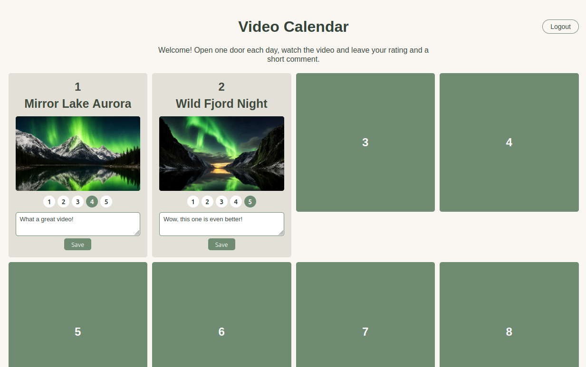

# Video Calendar

An interactive (advent) calendar for videos with rating functionality, built as a static website with a small PHP API.



## Features

- 24-door advent calendar
- Video previews with thumbnails
- Rating system (1-5)
- Comment field per video with save button
- Sequential door opening (doors unlock one after another)
- Data persistence via a CSV file
- Simple password protection (the site, including its API, is only visible after login)
- Configurable favicon

## Tech Stack

- **Frontend**: Static HTML/CSS/JavaScript (no build step)
- **API**: Single PHP script (`api.php`)
- **Data Storage**: `src/data.csv` (flat-file, written with `flock` + `LOCK_EX`)

## Getting Started

### Prerequisites

- PHP 7.4+ (no extensions required)

### Development

Copy `config.php.example` to `config.php` and set your desired password:

```bash
cp config.php.example config.php
```

`config.php` supports the following keys:

- `password` – the plain login password. Alternatively, store a
  [password hash](https://www.php.net/manual/en/function.password-hash.php)
  in `password_hash` (e.g. via `php -r "echo password_hash('secret', PASSWORD_DEFAULT);"`).
  If `password_hash` is set, it takes precedence and the plain `password` is ignored.
- `favicon` – optional path or URL to your own favicon (e.g. `src/favicon.ico`).
  When empty, a built-in inline SVG favicon is used.

Start local server
```bash
php -S localhost:8000
```

Open [http://localhost:8000](http://localhost:8000) in your browser, you will be redirected to `login.php` and asked for the password.

Any web server with PHP support works too, just point it at this directory.

## API Endpoint

- `GET api.php` - Returns `{ doors }` for all 24 doors (missing rows in the CSV are filled with defaults)
- `POST api.php` - Updates progress; body: `{ "doors": [{ "day", "opened_date", "rating", "comment" }] }`. Video metadata (title/url/thumbnail) is only changed by editing the CSV.

## How It Works

1. On page load, `index.php` fetches the doors from `GET api.php`
2. When a door is opened, rated or commented on, the progress is saved via `POST api.php`
3. `api.php` reads and writes `src/data.csv`, using `LOCK_EX` to protect against simultaneous writes

## Customization

### Adding Videos

Edit `src/data.csv` with the following format (`;` as separator). A door counts as opened when `opened_date` is not empty:

```csv
day;title;url;thumbnail;opened_date;rating;comment
1;Video Title;https://example.com/video1;src/thumbnails/01.png;;;
```

### Adding Thumbnails

Place thumbnail images in `/src/thumbnails/` with filenames matching the `thumbnail` references (`01.png` to `24.png`).